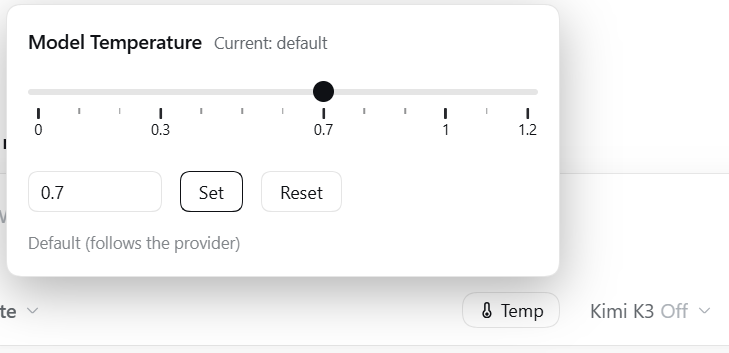

# dsh-temperature-picker

English | [中文](README.zh.md)

A [DeepSeek Harness](https://github.com/deepseek-ai/deepseek-harness) plugin that adds a **temperature picker button right next to the model selector** (on its left) in the composer. Click it to open a panel with a ticked slider (0–1.2, step 0.1) and a range-checked numeric input, tuning the `temperature` of every model call.



## Features

- 🎚️ Ticked slider (0–1.2, step 0.1; labeled marks at 0 / 0.3 / 0.7 / 1 / 1.2), applied on release
- 🔢 Direct numeric input with range validation
- ⚡ **Live-applied, no restart**: the value is a volatile config field
- 💾 Persisted automatically into the active profile's `cordis.patch.yml`
- ↩️ One-click "restore default" (sends no `temperature`, follows the provider default)
- 🌐 Applies to all providers (official DeepSeek routes and pi-ai third-party routes alike); interception happens before provider routing
- 💬 Safe to change mid-conversation; takes effect on the next model request

## Install

Requires DeepSeek Harness (tested on v0.2.1-rc.3).

**npm (once published):**

```sh
dsh plugin --profile web add dsh-temperature-picker
```

**GitHub:**

```sh
dsh plugin --profile web add github:ChurSu/dsh-temperature-picker
```

**Desktop app** (the `desktop` profile is owned by Electron; use the bundled CLI):

```sh
"<install-dir>\resources\runtime\cli\bin\dsh.cmd" plugin --profile desktop add dsh-temperature-picker
```

Or use the in-app Plugins page. Refresh the page (or restart the app) after installing; a「温度」/ temperature button appears at the bottom-left of the composer.

## Usage

1. Click the temperature button left of the model selector.
2. Drag the slider (applies on release) or type a value and press Enter / 「设定」.
3. The button shows the active value; 「恢复默认」clears the override.

## How it works

Both halves follow DSH's "everything is a plugin" composition:

- **Host** (`index.js`): declares a volatile `temperature` config field and merges it into every `LlmCallConfig` inside the `agent/request` waterfall (the legal mutation point before requests are frozen). **When unset, it actively `delete`s `temperature` from the config** — necessary because the agent loop starts subsequent requests from the folded `request/header` snapshot, where a previously injected value would otherwise stick (this plugin owns the field).
- **Client** (`client.js`): registers into the `conversation.input.right` slot (rendered immediately left of the model selector) and reads/writes the host entry's volatile field through `ctx.remote.settings.describe/mutate`; writes persist through the settings/config-editor into the profile's `cordis.patch.yml`.

Changing temperature is an envelope change: a new `request/header` (reason: `change`) is logged and a new request series begins; message history is unaffected.

## Notes

- **Models differ in what they accept**: e.g. the official DeepSeek route accepts but **ignores** temperature while thinking is enabled. If a provider rejects a value, pick a supported one or restore the default.
- When unset, the plugin sends no `temperature` at all — behavior is identical to not having the plugin.
- Personal project, MIT licensed. DSH is in developer preview; upstream API changes may require plugin updates (see peerDependencies in package.json).

## Repository layout

```
dsh-temperature-picker/
├── index.js          # Host: volatile config + agent/request injection
├── client.js         # Client: composer button + slider panel (plain React.createElement, no build step)
├── cordis.patch.yml  # Bundle layer: inserts the plugin row into the profile
├── package.json      # dsh.bundle / dsh.client declarations
└── assets/           # Docs screenshots
```

## Local development

- Client changes: picked up by DSH's client HMR (or a page refresh).
- Host changes: require an app restart (module code is not part of config-level HMR).

Debugging tip: the `request/header` event in a session log carries `config.temperature` — exactly what the model received ("model-visible means logged").

## License

[MIT](LICENSE)
