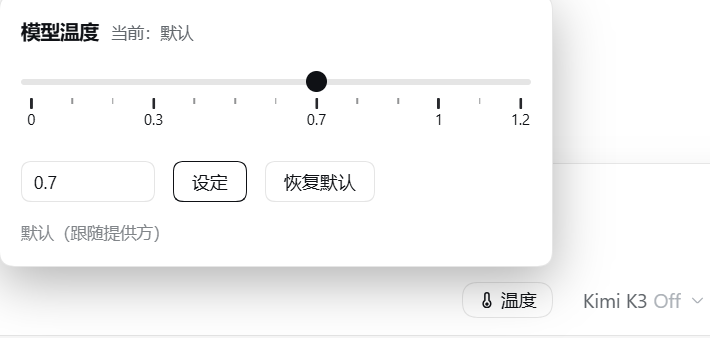

# dsh-temperature-picker

[English](README.md) | 中文

[DeepSeek Harness](https://github.com/deepseek-ai/deepseek-harness) 插件：在输入框的**模型选择按钮左侧**添加一个「温度」按钮，点击弹出面板，用带刻度滑条或直接输入来调整每次模型调用的 `temperature`（范围 0–1.2，步长 0.1）。



## 功能

- 🎚️ 带刻度滑条（0–1.2，步长 0.1；0 / 0.3 / 0.7 / 1 / 1.2 主刻度标注），松手即生效
- 🔢 支持直接输入数值，带范围检查（超出 0–1.2 会被拒绝并提示）
- ⚡ 改动**立即生效、无需重启**：配置是 volatile 字段，写入即热更新
- 💾 自动持久化：写入当前 profile 的 `cordis.patch.yml`，重启后仍生效
- ↩️ 「恢复默认」一键取消覆盖（不发送 temperature，跟随提供方默认）
- 🌐 作用于所有 provider（官方 DeepSeek 与 pi-ai 第三方路由），拦截发生在 provider 路由之前
- 💬 同一轮对话中间可随时修改，对下一次模型请求生效

## 安装

前提：已在使用 DeepSeek Harness（v0.2.1-rc.3 测试通过）。

**npm（发布后）：**

```sh
dsh plugin --profile web add dsh-temperature-picker
```

**GitHub：**

```sh
dsh plugin --profile web add github:ChurSu/dsh-temperature-picker
```

**桌面版（desktop profile 由 Electron 管理，用自带 CLI）：**

```sh
"<安装目录>\resources\runtime\cli\bin\dsh.cmd" plugin --profile desktop add dsh-temperature-picker
```

也可以在界面的「插件」页搜索安装。安装后刷新页面（或重启应用），输入框左下即出现「温度」按钮。

## 使用

1. 点击输入框左下角的「温度」按钮（模型选择按钮左侧）。
2. 拖动滑条（松开生效）或在输入框键入数值后回车 / 点「设定」。
3. 按钮上会显示当前生效的温度值；点「恢复默认」回到提供方默认。

## 工作原理

插件分两半，均遵循 DSH「一切皆插件」的组合机制：

- **宿主端**（`index.js`）：声明一个 volatile 配置字段 `temperature`，并在 `agent/request` 瀑布事件（请求冻结前的合法修改点）里把它合并进每次模型调用的 `LlmCallConfig`。**未设置时会主动 `delete` 掉配置里的 temperature**——这是必要的：agent 循环对后续请求从折叠的 `request/header` 快照出发，先前注入过的值若不主动清除会一直残留（本插件独占管理该字段）。
- **客户端**（`client.js`）：注册到 `conversation.input.right` 槽位（正好渲染在模型选择器左侧），通过 `ctx.remote.settings.describe/mutate` 读写宿主端条目的 volatile 字段；写入经 settings/config-editor 持久化到 profile 的 `cordis.patch.yml`。

改动温度属于请求 envelope 变化，会记录一条新的 `request/header`（reason: `change`）并开启新的 request series；消息历史不受影响。

## 注意事项

- **不同模型对温度的支持不同**：例如 DeepSeek 官方路由在 thinking（推理）开启时接受但**忽略** temperature。报错时改回模型支持的取值或恢复默认即可。
- 未设置时插件不发送 `temperature` 字段，行为与未安装插件完全一致。
- 本插件为个人工具，按 MIT 发布；DSH 处于开发者预览期，上游 API 变动可能导致插件需要适配（见 package.json 的 peerDependencies）。

## 目录结构

```
dsh-temperature-picker/
├── index.js          # 宿主端：volatile 配置 + agent/request 注入
├── client.js         # 客户端：输入栏按钮 + 滑条面板（原生 React.createElement，无构建步骤）
├── cordis.patch.yml  # bundle 层：向 profile 插入插件行
├── package.json      # dsh.bundle / dsh.client 声明
└── assets/           # 文档截图
```

## 本地开发

修改 `index.js` / `client.js` 后：

- 客户端改动：DSH 的 client HMR 会自动热更新（或刷新页面）；
- 宿主端改动：需要重启应用（模块代码不参与配置级热重载）。

调试技巧：会话日志里 `request/header` 事件的 `config.temperature` 就是模型实际收到的值（"模型可见即已落盘"）。

## License

[MIT](LICENSE)
